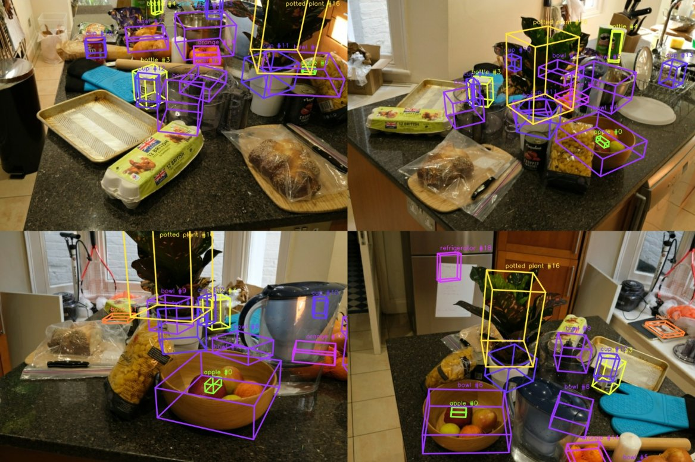
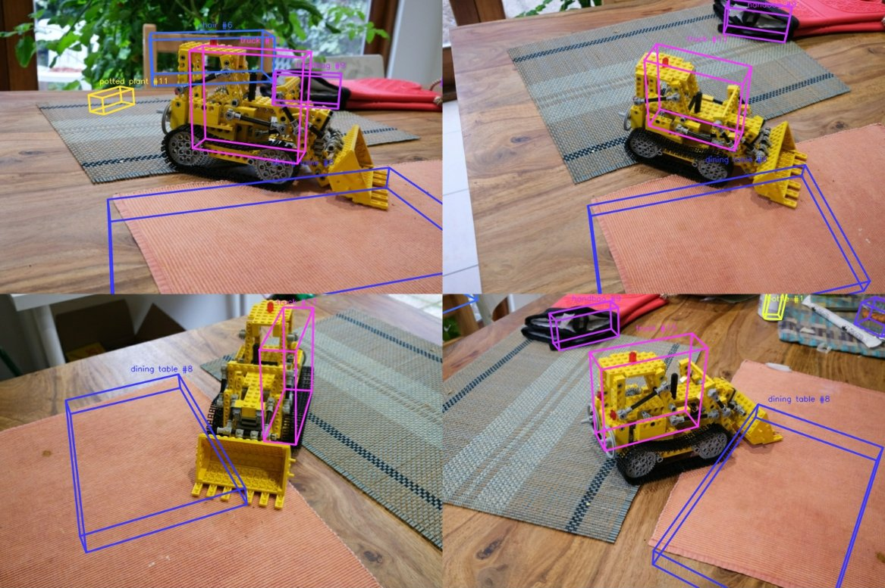
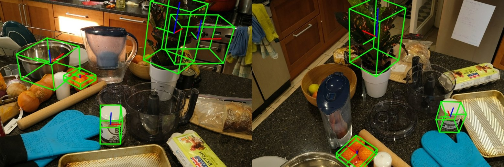

# multiview-3d-perception

Object-aware 3D reconstruction: build a 3D model of a scene from ordinary photos,
find the objects in it with a deep learning detector, place each one as a labelled
3D bounding box, and recover the 6DoF pose of those objects in new, unseen images.



*Mip-NeRF 360 "counter": every box is a fused 3D object (bowl, apple, orange, plant,
jar…) projected back into some of the input views.*

Runs natively on **Windows** (and Linux) in a plain Python virtual environment.
No ROS is needed. An NVIDIA GPU speeds up YOLO but is optional.

## How it works

| Stage | What happens | Main tools |
|---|---|---|
| `sparse` | SIFT features, matching, incremental Structure-from-Motion, undistortion | pycolmap |
| `dense` | Pairwise rectification from known poses, semi-global stereo matching, multi-view consistent depth fusion | OpenCV, Open3D |
| `detect` | YOLOv11 instance segmentation on every registered image | Ultralytics, PyTorch |
| `fuse` | 2D masks lifted to 3D through SfM tracks, voted per point, linked across views, clustered and fitted with gravity-aligned 3D boxes | NumPy, SciPy |
| `pose` | Each object becomes a 2D-3D feature model. In held-out images: YOLO box, SIFT matching, PnP + RANSAC, then evaluation against reference poses | OpenCV, pycolmap |
| `viz` | Interactive HTML viewer (point cloud + 3D boxes + cameras) and PLY exports | Plotly, Open3D |

Some design points:

- **Exact 2D-3D association.** Instead of guessing depth for each mask, the fusion
  uses the SfM tracks: every sparse 3D point knows which keypoints in which images
  observed it. A point gets a class label only when most images that see it put it
  inside a mask of that class, which removes background points that leak into masks.
- **Cleaning up detector noise in 3D.** Detections are linked across views by shared
  3D points and then split spatially. Fragments of one object (a plant seen from
  different sides) are merged. One object given two labels (a jar called "cup" in
  some frames and "bottle" in others) keeps the more frequent label. Objects that are
  detected in only a tiny fraction of the views that see them are dropped as
  sporadic false positives.
- **Dense stereo without CUDA.** The default dense back-end rectifies each view with
  its best neighbours, including vertical and "source on the left" pairs, runs SGBM,
  and keeps only depths that agree across views. If you have a CUDA build of COLMAP,
  set `dense.method: colmap` to use PatchMatch MVS instead.
- **Honest pose evaluation.** Every 8th image (the standard Mip-NeRF 360 test split)
  is excluded from reconstruction. Object poses are estimated in those unseen images
  and compared with the dataset's reference poses after a 7-DoF Umeyama alignment.

## Results (Mip-NeRF 360, 1/4 resolution, every stage run from scratch)

| | counter | kitchen |
|---|---|---|
| Images registered by SfM | 210 / 210 | 244 / 244 |
| Camera rotation error vs. reference (median) | 0.08° | 0.18° |
| Camera position error (ATE, % of scene size) | 0.04 % | 0.14 % |
| Dense point cloud | ~0.7 M points | ~1.2 M points |
| Objects found (YOLO labels) | 20: bowls, cups, bottles/jars, apple, orange net, plant, sink, oven, fridge… | 14: Lego "truck", chairs, handbag, table, bottles, cup, plants… |
| 6DoF pose, held-out views: PnP solved | 63 / 67 queries | 21 / 22 queries |
| Median rotation error / median ADD | 0.53° / 2.2 % of diameter | 0.23° / 0.9 % of diameter |
| ADD < 10 % of diameter | 89 % of solved (84 % of all) | 95 % of solved (91 % of all) |





*Held-out test images from "counter": estimated poses (green box and axes) are drawn
over the reference poses (red), which they almost completely hide.*

The numbers come from `outputs/<scene>/metrics.json` after a CPU-only run in a cloud
container (SfM ≈ 6–12 min per scene, the rest a few minutes). Expect small
differences on other machines.

### Known limitations

- Box quality is bounded by the 2D masks: when masks bleed onto the table, the
  fused box grows a little. Box extents are trimmed at robust percentiles
  (`fusion.box_percentile`), which also slightly shrinks thin parts (e.g. the
  bulldozer's bucket in "kitchen").
- Labels are COCO classes, so objects outside COCO get the nearest class (the Lego
  bulldozer in "kitchen" is a "truck"), and some background objects get wrong labels.
- The pose stage locates objects by matching against the scene model. It needs the
  same object instance as in the reconstruction, not just the same category.

## Setup

Python **3.11** is required (Open3D 0.18 has no wheels for 3.12+). Every package
version is pinned in `requirements.txt` and `requirements-torch.txt`, and the setup
script installs them into a local `.venv`, so the project does not depend on, or
interfere with, anything else installed on your machine.

**Windows (PowerShell):**

```powershell
powershell -ExecutionPolicy Bypass -File setup_env.ps1            # NVIDIA GPU (CUDA 12.4 PyTorch)
powershell -ExecutionPolicy Bypass -File setup_env.ps1 -Cuda cpu  # no GPU
.\.venv\Scripts\Activate.ps1
```

**Linux / macOS:**

```bash
./setup_env.sh          # or: ./setup_env.sh cpu
source .venv/bin/activate
```

If you don't have Python 3.11, install it from python.org. On Windows the `py`
launcher picks it up automatically.

## Usage

```bash
# 1. Download one scene. Only that scene is fetched (~150 MB at 1/4 resolution),
#    not the full 12.5 GB archive.
python scripts/download_mipnerf360.py --scene counter --resolution 4

# 2. Run all stages
python scripts/run_pipeline.py --config configs/mipnerf360_counter.yaml

# Re-run only some stages, or override settings from the command line
python scripts/run_pipeline.py --config configs/mipnerf360_counter.yaml --stages fuse pose viz
python scripts/run_pipeline.py --config configs/mipnerf360_counter.yaml --set detection.confidence=0.5 dense.method=colmap
```

After `pip install -e .` (done by the setup script), the same commands are also
available as `mv3dp-download` and `mv3dp-run`.

Configs are provided for the four indoor scenes: `counter`, `kitchen`, `room` and
`bonsai`. To use your own photos, put them in `<scene>/images/` and copy a config.
Without a `reference_sparse/` folder the pipeline still runs; only the accuracy
evaluation is skipped.

### Outputs (`outputs/<scene>/`)

| Path | Content |
|---|---|
| `viewer.html` | Interactive 3D viewer: open it in a browser |
| `objects/instances.json` | Every object: class, score, views, 3D box (center, size, rotation) |
| `objects/boxes.ply`, `dense/fused.ply` | Boxes and dense cloud for MeshLab / CloudCompare |
| `detections/preview/` | YOLO masks drawn on sample images |
| `pose/vis/`, `pose/poses.json` | Estimated (green) vs. reference (red) poses on held-out images |
| `metrics.json` | Reconstruction and pose accuracy |
| `sfm/`, `undistorted/` | COLMAP database and models |

## Project layout

```
configs/            one YAML per scene (all options: src/mv3dp/config.py)
scripts/            download + run entry points
src/mv3dp/
  data/             Mip-NeRF 360 downloader (HTTP range requests into the zip)
  reconstruction/   sparse SfM (pycolmap) and dense stereo
  detection/        YOLOv11 wrapper, mask rasterisation
  fusion/           multi-view 2D->3D fusion and 3D boxes
  pose/             object feature models, PnP, ADD metric
  evaluation/       Umeyama alignment to reference poses
  viz/              HTML viewer, PLY export, box overlays
tests/              unit tests on synthetic scenes (pytest)
```

## Tests

```bash
pytest
```

The tests use synthetic data: stereo depth on a textured plane (all four baseline
directions), multi-view fusion of masked objects with background leakage, PnP with
30 % outliers and lens distortion, box fitting, alignment and config loading.

## License

MIT, see [LICENSE](LICENSE).
